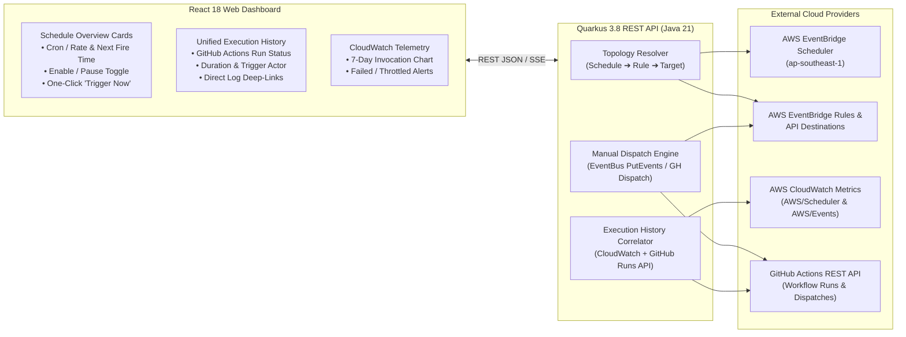

# AWS EventBridge Scheduler Dashboard ⏱️🚀

> **Unified Control Plane & Execution Observability Dashboard for AWS EventBridge Scheduler & GitHub Actions Pipelines**

[](LICENSE)
[](#)
[](#)
[](#)
[](#)

---

## 📖 1. Project Background & Motivation

**AWS EventBridge Scheduler** provides a serverless, highly reliable, and cost-effective cron scheduling engine (14,000,000 free invocations/month under the AWS Always Free tier). However, using AWS EventBridge Console directly for daily operations and pipeline management suffers from three major operational pain points:

1. **Zero Native Execution History Log**: Unlike traditional job schedulers (e.g., Airflow, XXL-Job, or Rundeck), AWS EventBridge Scheduler is a stateless fire-and-forget trigger. It does **not** provide a built-in table showing past execution timestamps, run statuses (`SUCCESS` / `FAILURE`), execution duration, or downstream job logs.
2. **No "Run Now" Manual Trigger Button**: Testing or manually re-running a scheduled job in AWS Console requires either temporarily modifying the cron expression to a few minutes in the future or manually crafting a JSON payload in the EventBridge EventBus "Send Events" tool.
3. **Fragmented Multi-Hop Topology**: In modern GitOps & Cloud-Native architectures, a schedule often routes through an EventBridge `Rule` ➔ `API Destination` ➔ `GitHub Actions Workflow` (e.g., triggering Flink lakehouse batch ETL jobs or automated TLS certificate renewals). Operators must jump across 4 different AWS and GitHub pages to trace a single job's config and outcome.

**AWS EventBridge Scheduler Dashboard (`aws-scheduler-dashboard`)** bridges this gap without reinventing the scheduling wheel. Instead of building a heavy, stateful scheduler, it acts as a **stateless, ultra-lightweight Java 21 (Quarkus) + React 18 Control Plane** that correlates AWS EventBridge schedules with CloudWatch telemetry and downstream GitHub Actions workflow runs in a single unified glass pane.

---

## 🎯 2. Core Capabilities & Value Proposition



### 1. Automatic End-to-End Topology Discovery
- Dynamically queries AWS EventBridge Scheduler (`ListSchedules` / `GetSchedule`), EventBridge Rules (`ListRules` / `ListTargetsByRule`), and API Destinations (`ListApiDestinations`).
- Automatically resolves the complete routing chain for every job:
  - **Schedule Layer**: Name, Group, Cron/Rate Expression, Timezone (e.g., `Asia/Shanghai`, `UTC`), Next Fire Time, and State (`ENABLED` / `DISABLED`).
  - **Event Routing Layer**: Source & Detail-Type matching rules (e.g., `finance.sms-flink-report` / `daily-report`).
  - **Target Execution Layer**: Target GitHub Repository, Workflow File (`.yml`), Branch (`ref`), and injected JSON `inputs` (e.g., `target_env=finance`, `report_period=DAILY`).

### 2. Unified Execution History & Status Tracking
- Combines **AWS CloudWatch Metrics** (`InvocationAttemptCount`, `SuccessfulInvocationAttempts`, `FailedInvocations`) with **GitHub Actions Workflow Runs API** (`/repos/{owner}/{repo}/actions/workflows/{workflow_id}/runs`).
- Filters and correlates downstream runs with each schedule's specific inputs/window, displaying:
  - Run ID, Status (`completed`, `in_progress`, `queued`), and Conclusion (`success`, `failure`, `cancelled`).
  - Start Time, Execution Duration, Trigger Event (`workflow_dispatch`), and one-click deep links to GitHub Actions step logs.

### 3. One-Click Manual Trigger ("Run Now") & Parameter Override
- Provides an instant **"Trigger Now" (`立即运行`)** button on every schedule card.
- Supports two execution modes:
  1. **Native EventBridge Emulation**: Calls AWS `events:PutEvents` with the exact `Source`, `DetailType`, and `Input` payload configured on the schedule, exercising the full AWS Rule ➔ API Destination pipeline.
  2. **Direct GitHub Workflow Dispatch (with Custom Inputs)**: Allows operators to preview and optionally override workflow `inputs` (e.g., switching `force_renew` from `false` to `true`, or selecting `report_period=WEEKLY`) before dispatching directly to GitHub Actions.

### 4. Lifecycle & Cron Management
- **Instant Pause / Resume**: One-click toggle to switch a schedule between `ENABLED` and `DISABLED` via `scheduler:UpdateSchedule`.
- **Cron & Timezone Editor**: Interactive modal with human-readable cron translation (e.g., `cron(50 23 * * ? *)` ➔ *"Every day at 23:50 Asia/Shanghai"*) and next-5-fire-times preview.

---

## 📋 3. Target Production Schedules Inventory (`ap-southeast-1`)

The dashboard is designed out-of-the-box to govern and monitor the following active schedules in AWS Account `186004631963`:

| Schedule Name | Schedule Expression | Timezone | Event Source / Detail-Type | Downstream Target Workflow & Inputs |
| :--- | :--- | :---: | :--- | :--- |
| **`test-sms-flink-cron`** | `rate(10 minutes)` | `UTC` | `finance.sms-flink`<br>`minutely-tick` | `nvd11/sms-flink-etl`<br>`trigger-nuc-batch-runner.yml` *(ODS+DWD Incremental Ingest)* |
| **`sms-flink-report-daily`** | `cron(50 23 * * ? *)` | `Asia/Shanghai` | `finance.sms-flink-report`<br>`daily-report` | `nvd11/sms-flink-etl`<br>`trigger-nuc-batch-runner.yml` (`report_period=DAILY`) |
| **`sms-flink-report-weekly`** | `cron(0 9 ? * MON *)` | `Asia/Shanghai` | `finance.sms-flink-report`<br>`weekly-report` | `nvd11/sms-flink-etl`<br>`trigger-nuc-batch-runner.yml` (`report_period=WEEKLY`) |
| **`sms-flink-report-monthly`** | `cron(30 9 1 * ? *)` | `Asia/Shanghai` | `finance.sms-flink-report`<br>`monthly-report` | `nvd11/sms-flink-etl`<br>`trigger-nuc-batch-runner.yml` (`report_period=MONTHLY`) |
| **`jppwl-tls-cert-renew-weekly`** | `cron(0 4 ? * SUN *)` | `Asia/Shanghai` | `infra.tls-cert`<br>`renew-jppwl-tls` | `nvd11/my-argocd-manifests`<br>`renew-jppwl-tls.yml` (`threshold_days=30`) |

---

## 📂 4. Planned Repository Structure

```text
aws-scheduler-dashboard/
├── README.md                           # Project overview, capabilities & quickstart
├── LICENSE                             # MIT License
├── .env-template                       # Standardized environment variable template
├── .gitignore                          # Git ignore rules for Java/Maven & Node/Vite
├── docs/
│   ├── REQUIREMENTS.md                 # System Requirements Specification (SRS)
│   └── ARCHITECTURE.md                 # Full-Stack System Architecture, APIs & Sequence Flows
├── backend/                            # Java 21 + Quarkus 3.8 REST Backend (No Built-in Cron)
│   ├── pom.xml                         # Maven dependencies (Quarkus REST Jackson, AWS SDK v2)
│   ├── Dockerfile.jvm                  # Multi-arch JVM container image definition
│   └── src/main/java/asia/jppwl/scheduler/
│       ├── config/                     # AWS & GitHub client producers and config mapping
│       ├── model/                      # DTOs (SchedulePipelineView, ExecutionRecord, TriggerRequest)
│       ├── service/
│       │   ├── AwsTopologyService.java # Correlates Scheduler -> EventBridge Rule -> API Destination
│       │   ├── CloudWatchService.java  # Fetches Invocation/Failure metrics per schedule/rule
│       │   ├── GitHubActionsClient.java# Queries workflow_runs & triggers workflow_dispatch
│       │   └── JobControlService.java  # Handles Pause/Resume, Cron Update & PutEvents Trigger
│       └── resource/
│           └── SchedulerResource.java  # REST API controllers (/api/v1/schedules, /trigger, /runs)
└── web/                                # React 18 + TypeScript + Vite + Tailwind CSS Frontend
    ├── package.json
    ├── vite.config.ts
    └── src/
        ├── components/                 # ScheduleCard, RunHistoryDrawer, TriggerModal, MetricSparkline
        ├── pages/                      # DashboardHome, PipelineTopologyView
        ├── services/                   # Typed Axios/Fetch API client
        └── App.tsx
```

---

## 🏗️ 5. Documentation Index

Detailed functional requirements, REST API contracts, data models, and deployment topologies are documented in:
- 📄 **[System Requirements Specification (SRS)](docs/REQUIREMENTS.md)**
- 🏛️ **[System Architecture & Technical Specification](docs/ARCHITECTURE.md)**
