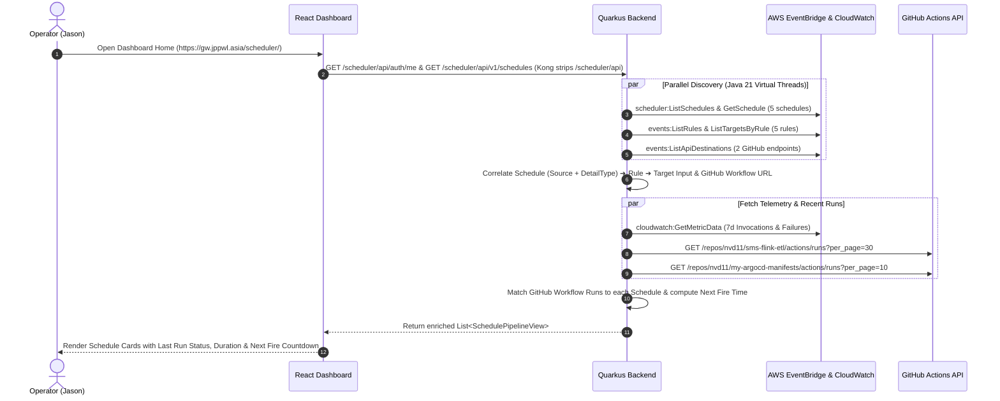
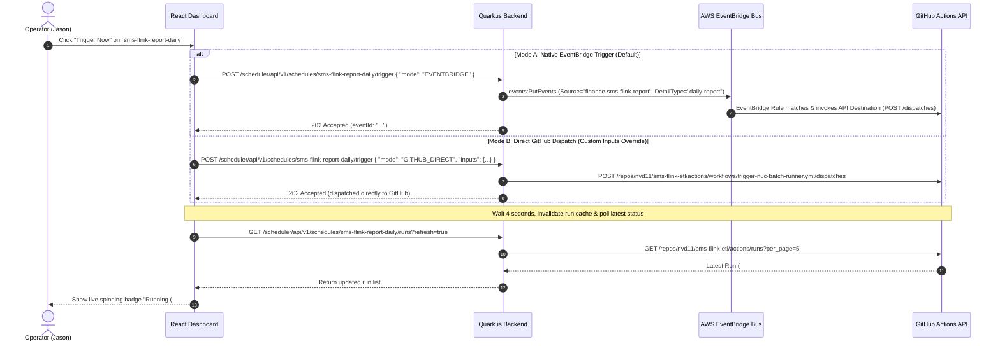

# System Architecture & Technical Specification

**Project Name:** AWS EventBridge Scheduler Dashboard (`aws-scheduler-dashboard`)  
**Architecture Style:** Stateless Cloud Control Plane (Dual-Pod: React 18 Nginx SPA + Quarkus 3.8 GraalVM Native Backend)  
**Backend Runtime:** Java 21 + Quarkus 3.8 compiled to **GraalVM / Mandrel Native Image** (`<64MB RAM`, AWS SDK v2 `url-connection-client`)  
**Frontend Runtime:** React 18 + TypeScript + Vite (`base: '/scheduler/'`) + Tailwind CSS + Nginx 1.27 Alpine  
**Auth & Edge Routing:** Cloudflare Same-Origin (`gw.jppwl.asia`) + Kong (`oauth2-forward-auth`) + OAuth2-Proxy + Logto (GitHub OAuth)  
**Target Deployment:** K3s Cluster B (`tencent-dp1-cluster`) via ArgoCD GitOps (`scheduler-frontend` & `scheduler-backend`)  
**Document Version:** 1.1.0  

---

## 1. Architectural Overview & Why Quarkus Native?

Although this project is a **pure Dashboard & Control Plane** (and **not** a new scheduling engine), **Quarkus 3.8 (Java 21) compiled to GraalVM / Mandrel Native Image** is selected for the backend REST API layer for four architectural reasons:
1. **Extreme Memory Economy (`<64MB RSS`)**: Cluster memory on K3s nodes is precious. Compiling the stateless Quarkus backend into a GraalVM Native binary eliminates JVM JIT/Metaspace overhead, booting in **<50ms** and running comfortably inside **35MB–64MB RAM** (`-Xmx48m`).
2. **Native-Friendly Dependency Design**:
   - Uses Quarkus Amazon Services extensions (`quarkus-amazon-scheduler`, `quarkus-amazon-eventbridge`, `quarkus-amazon-cloudwatch`) backed by the lightweight synchronous **`url-connection-client`** (avoiding Netty/Apache HTTP native memory bloat).
   - Implements a zero-reflection, zero-dependency **`AwsCronEvaluator`** on top of `java.time.ZonedDateTime` rather than heavy reflection-based third-party cron libraries.
   - Uses Java 21 `record` DTOs annotated with `@RegisterForReflection`.
3. **1:1 Alignment with `astra` Architecture**: Reuses the exact same dual-pod deployment pattern (`scheduler-frontend` + `scheduler-backend`), shared Helm chart (`my-shared-helm-charts/charts/generic-web-service-v2`), Cloudflare same-origin routing, and Kong + Logto + GitHub `oauth2-forward-auth` SSO pipeline used by `astra`.
4. **Non-Blocking Cloud API Fan-Out**: Java 21 **Virtual Threads (`@RunOnVirtualThread`)** in Quarkus allow clean, synchronous-style code over `url-connection-client` that executes external AWS/GitHub HTTP calls concurrently with zero thread-pool exhaustion.

---

## 2. End-to-End System Architecture (Cloudflare Same-Origin + Kong Forward-Auth)

```mermaid
flowchart TB
    subgraph Client["1. Client Tier (Browser)"]
        SPA["React 18 + Vite SPA<br/>• Base Path: /scheduler/<br/>• API Client: /scheduler/api (Same-Origin)<br/>• Zero JWT in localStorage (HttpOnly Cookie)"]
    end

    subgraph Edge["2. Cloudflare Edge & Kong Zero-Trust Gateway (tencent-dp1-cluster)"]
        CF["Cloudflare CDN & Edge SSL<br/>(gw.jppwl.asia / gw-tx.jppwl.asia)"]
        Kong["Kong Ingress Gateway<br/>(Lua Plugin: oauth2-forward-auth)"]
        OAuth2Proxy["OAuth2-Proxy (:4180)<br/>(.jppwl.asia Cookie Validator)"]
        Logto["Logto Cloud IdP (sodaxw.logto.app)<br/>+ GitHub OAuth"]

        CF -->|HTTPS| Kong
        Kong <-->|1. GET /oauth2/auth| OAuth2Proxy
        OAuth2Proxy -.->|302 Redirect if unauthenticated| Logto
    end

    subgraph FrontendPod["3A. scheduler-frontend Pod (Nginx 1.27 Alpine)"]
        Nginx["Nginx Static Server (:80)<br/>• Serves /usr/share/nginx/html/scheduler<br/>• Liveness/Readiness: GET /health"]
    end

    subgraph Backend["3B. scheduler-backend Pod (Quarkus 3.8 GraalVM Native <64MB RAM)"]
        AuthRes["AuthResource (/auth/me, /auth/logout)<br/>Reads X-Auth-Request-* Headers"]
        API["SchedulerResource (/v1/schedules/*)"]
        Cache["Caffeine In-Memory Cache<br/>(Topology: 60s | Runs: 15s | UserInfo: 300s)"]
        
        subgraph Services["Core Domain Services"]
            TopoSvc["AwsTopologyService<br/>(Schedule ➔ Rule ➔ Target Resolver)"]
            CronSvc["AwsCronEvaluator<br/>(Zero-Reflection Cron/Rate Parser)"]
            ControlSvc["JobControlService<br/>(Enable/Disable, Edit Cron, Trigger)"]
            CorrelatorSvc["ExecutionCorrelatorService<br/>(Run Attribution & CloudWatch Merger)"]
        end

        subgraph Clients["External SDK & REST Clients (URLConnection)"]
            SchedSdk["AWS SchedulerClient (SDK v2)"]
            EventsSdk["AWS EventBridgeClient (SDK v2)"]
            CwSdk["AWS CloudWatchClient (SDK v2)"]
            GhClient["GitHub Actions REST Client"]
        end

        API --> TopoSvc & CronSvc & ControlSvc & CorrelatorSvc
        TopoSvc & CorrelatorSvc & AuthRes <--> Cache
        TopoSvc --> SchedSdk & EventsSdk
        ControlSvc --> SchedSdk & EventsSdk & GhClient
        CorrelatorSvc --> CwSdk & GhClient
    end

    subgraph External["4. External Cloud Providers"]
        AWS["AWS ap-southeast-1 (Account: 186004631963)<br/>• EventBridge Scheduler<br/>• EventBridge Rules & API Destinations<br/>• CloudWatch Metrics"]
        GitHub["GitHub REST API (api.github.com)<br/>• nvd11/sms-flink-etl<br/>• nvd11/my-argocd-manifests"]
    end

    SPA -->|HTTPS Same-Origin| CF
    Kong -->|Route 1: /scheduler (strip-path=false)| Nginx
    Kong -->|Route 2: /scheduler/api (strip-path=true)<br/>+ Inject X-Auth-Request-*| AuthRes & API
    SchedSdk & EventsSdk & CwSdk -->|HTTPS (IAM moon-cli)| AWS
    GhClient -->|HTTPS (Bearer GITHUB_TOKEN)| GitHub
```

---

## 3. Core Sequence Flows

### 3.1 Topology Discovery & Execution History Correlation Flow



### 3.2 One-Click Manual Trigger ("Run Now") Flow



---

## 4. Data Models & REST API Specification

### 4.1 Core Domain DTO (`SchedulePipelineView`)

```json
{
  "name": "sms-flink-report-daily",
  "groupName": "default",
  "arn": "arn:aws:scheduler:ap-southeast-1:186004631963:schedule/default/sms-flink-report-daily",
  "description": "Nightly 23:50 (Asia/Shanghai) financial daily report trigger",
  "state": "ENABLED",
  "scheduleExpression": "cron(50 23 * * ? *)",
  "timezone": "Asia/Shanghai",
  "humanReadableCron": "Every day at 23:50 (Asia/Shanghai)",
  "nextFireTime": "2026-10-17T15:50:00Z",
  "lastModifiedDate": "2026-10-14T18:30:06Z",
  "routing": {
    "eventBusName": "default",
    "source": "finance.sms-flink-report",
    "detailType": "daily-report",
    "matchedRuleName": "rule-trigger-github-daily-report",
    "apiDestinationName": "github-trigger-nuc-batch",
    "invocationEndpoint": "https://api.github.com/repos/nvd11/sms-flink-etl/actions/workflows/trigger-nuc-batch-runner.yml/dispatches",
    "githubOwner": "nvd11",
    "githubRepo": "sms-flink-etl",
    "workflowFile": "trigger-nuc-batch-runner.yml",
    "targetRef": "main",
    "defaultInputs": {
      "target_env": "finance",
      "pipeline_stage": "report",
      "report_period": "DAILY"
    }
  },
  "metrics7d": {
    "invocations": 7,
    "successfulInvocations": 7,
    "failedInvocations": 0
  },
  "lastExecution": {
    "runId": 1948271625,
    "runNumber": 88,
    "displayTitle": "Batch ETL [report - DAILY]",
    "attributionMethod": "DISPLAY_TITLE",
    "status": "completed",
    "conclusion": "success",
    "startedAt": "2026-10-16T15:50:04Z",
    "updatedAt": "2026-10-16T15:52:19Z",
    "durationSeconds": 135,
    "htmlUrl": "https://github.com/nvd11/sms-flink-etl/actions/runs/1948271625"
  }
}
```

### 4.2 REST API Endpoints (`AuthResource`, `HealthResource` & `SchedulerResource`)

> **Note on Same-Origin Strip-Path Routing**: In production behind Kong Gateway, external browser requests target `/scheduler/api/...`. Kong's `HTTPRoute` is configured with `path: /scheduler/api` and `konghq.com/strip-path: "true"`, forwarding the stripped path directly to the Quarkus backend container on port `8080`. During local development (`vite.config.ts`), Vite proxies `/scheduler/api` to `http://localhost:8080` with the same prefix rewrite.

| Browser Path (via Kong / Vite) | Backend Internal Path | HTTP Method | Description |
| :--- | :--- | :---: | :--- |
| `/scheduler/api/live` | `/live` | `GET` | K8s liveness probe (`200 OK`) |
| `/scheduler/api/ready` | `/ready` | `GET` | K8s readiness probe (`200 OK`) |
| `/scheduler/api/auth/me` | `/auth/me` | `GET` | Returns current user profile parsed from Kong `X-Auth-Request-*` headers (or mock user `nvd11` when `APP_AUTH_ENABLED=false`) |
| `/scheduler/api/auth/logout` | `/auth/logout` | `POST` | Returns SSO sign-out redirect URL (`/oauth2/sign_out?rd=/scheduler/`) |
| `/scheduler/api/v1/health` | `/v1/health` | `GET` | System status + AWS/GitHub connectivity check |
| `/scheduler/api/v1/schedules` | `/v1/schedules` | `GET` | List all schedules with resolved topology, 7d metrics, and latest execution run |
| `/scheduler/api/v1/schedules/{name}` | `/v1/schedules/{name}` | `GET` | Get detailed configuration and next 5 fire times for a single schedule |
| `/scheduler/api/v1/schedules/{name}/runs` | `/v1/schedules/{name}/runs` | `GET` | Get correlated GitHub Actions execution history (`?limit=20&refresh=false`) |
| `/scheduler/api/v1/schedules/{name}/runs/{runId}/logs` | `/v1/schedules/{name}/runs/{runId}/logs` | `GET` | Get structured job `steps[]` and plain-text console log (`?jobId=&tailLines=500`) |
| `/scheduler/api/v1/schedules/{name}/trigger` | `/v1/schedules/{name}/trigger` | `POST` | Manually trigger a schedule (`mode`: `EVENTBRIDGE` or `GITHUB_DIRECT`, optional `inputs`) |
| `/scheduler/api/v1/schedules/{name}/state` | `/v1/schedules/{name}/state` | `PATCH` | Toggle schedule state (`{"state": "ENABLED" \| "DISABLED"}`) |
| `/scheduler/api/v1/schedules/{name}` | `/v1/schedules/{name}` | `PUT` | Update schedule expression, timezone, or description |

---

## 5. Topology Correlation & Run Attribution Algorithms

### 5.1 API Responsibility Split: Why Both AWS API and GitHub API Are Required
- **AWS APIs (`scheduler:*`, `events:*`, `cloudwatch:*`) — Job Definitions & Invocation Telemetry**:
  - AWS EventBridge Scheduler is a stateless "fire-and-forget" trigger. Once it dispatches an HTTP `POST` to the GitHub API Destination and receives `204 No Content`, AWS considers the invocation complete. AWS has **no API** to list historical job runs, downstream execution duration, or job failure logs.
  - Therefore, AWS APIs are used strictly to: (a) list/update schedules and their 3-hop routing topology, (b) fire manual `PutEvents` triggers, and (c) fetch 7-day aggregate invocation/failure counts from CloudWatch.
- **GitHub Actions REST API (`/actions/workflows/{workflow_id}/runs`) — Execution History & Logs**:
  - Queried by `ExecutionCorrelatorService` to retrieve actual run histories (`runId`, `runNumber`, `displayTitle`, `status`, `conclusion`, `durationSeconds`, and deep-link `htmlUrl` to step logs).

### 5.2 Three-Hop Topology Correlation (`AwsTopologyService`)
In AWS Account `186004631963`, schedules do not invoke GitHub directly; they follow a 3-stage decoupled pattern:
1. **Stage 1 (EventBridge Scheduler)**:
   - `Target.Arn` = `arn:aws:events:ap-southeast-1:186004631963:event-bus/default`
   - `Target.EventBridgeParameters` = `{ "Source": "<S>", "DetailType": "<D>" }`
2. **Stage 2 (EventBridge Rule on `default` bus)**:
   - `EventPattern` = `{"source": ["<S>"], "detail-type": ["<D>"]}` (or prefix match on `source` alone, as in `rule-trigger-github-workflow` where `source=["finance.sms-flink"]`).
   - Rule `Target.Input` = JSON payload sent to GitHub (e.g., `{"ref":"main","inputs":{...}}`).
   - Rule `Target.Arn` = `arn:aws:events:...:api-destination/<dest-name>/<uuid>`.
3. **Stage 3 (EventBridge API Destination)**:
   - `InvocationEndpoint` = `https://api.github.com/repos/{owner}/{repo}/actions/workflows/{workflow_file}/dispatches`.

`AwsTopologyService` builds this lookup graph in memory (cached for 60s) by:
1. Indexing all `ApiDestinations` by their ARN and parsing `{owner}`, `{repo}`, and `{workflow_file}` via regex `repos/([^/]+)/([^/]+)/actions/workflows/([^/]+)/dispatches`.
2. Indexing all EventBridge `Rules` and their `Targets`, parsing each rule's `EventPattern` JSON.
3. Matching each `Schedule`'s `(Source, DetailType)` tuple against the indexed `EventPattern` criteria to bind the complete pipeline metadata.

### 5.3 Multi-Schedule Run Attribution Algorithm (`ExecutionCorrelatorService`)
Because 4 separate Flink schedules (`test-sms-flink-cron`, `sms-flink-report-daily`, `sms-flink-report-weekly`, `sms-flink-report-monthly`) all trigger the same workflow file (`nvd11/sms-flink-etl` ➔ `trigger-nuc-batch-runner.yml`), GitHub's `/runs` endpoint returns an interleaved list of runs. `ExecutionCorrelatorService` disambiguates them using a **Dual-Layer Attribution Algorithm**:

1. **Layer 1: Exact `run-name` (`display_title`) Matching (Primary — 100% Accuracy)**:
   - In `trigger-nuc-batch-runner.yml`, the workflow header defines:
     ```yaml
     run-name: "Batch ETL [${{ inputs.pipeline_stage || 'ingest' }} - ${{ inputs.report_period || 'INCREMENTAL' }}]"
     ```
   - When GitHub Actions creates a run, `display_title` is populated with the evaluated `run-name` (e.g., `"Batch ETL [report - DAILY]"`).
   - `ExecutionCorrelatorService` compares each run's `display_title` against the `defaultInputs` of all schedules targeting that workflow (`report_period=DAILY` / `WEEKLY` / `MONTHLY` vs. `ingest`/`INCREMENTAL`).
   - This accurately attributes both scheduled runs and ad-hoc manual runs (`Trigger Now`) regardless of when they were triggered.
2. **Layer 2: Cron Firing Window Alignment (Fallback for Legacy Runs)**:
   - For historical runs triggered prior to the `run-name` enhancement (where `display_title` is simply the default workflow name), `AwsCronEvaluator` computes the most recent firing timestamp prior to `run.created_at` for each candidate schedule.
   - If `0 <= (run.created_at - scheduleFireTime) <= 180 seconds`, the run is attributed to the closest matching schedule (`attributionMethod = "CRON_WINDOW"`).

---

## 6. Authentication, Native Compilation & GitOps Deployment Plan

### 6.1 Kong + Logto + GitHub Forward-Auth Flow (Aligned with `astra`)
1. **Edge Cookie Validation**: Requests to `https://gw.jppwl.asia/scheduler/*` and `https://gw.jppwl.asia/scheduler/api/*` are intercepted by Kong's `oauth2-forward-auth` Lua plugin, which validates the `.jppwl.asia` `_oauth2_proxy` cookie against `http://oauth2-proxy.default.svc.cluster.local:4180/oauth2/auth`.
2. **Header Injection**: Upon `202 Accepted`, Kong strips any client-supplied `X-Auth-Request-*` headers and injects trusted headers into the upstream request to `scheduler-backend`:
   - `X-Auth-Request-User`: Logto user `sub` ID
   - `X-Auth-Request-Preferred-Username`: GitHub username (e.g., `nvd11`)
   - `X-Auth-Request-Email`: User email
   - `X-Auth-Request-Access-Token`: OIDC access token (used optionally to query `https://sodaxw.logto.app/oidc/me` for the GitHub avatar and login if `Preferred-Username` falls back to `sub`).
3. **No User Whitelist**: Any user who completes the Logto + GitHub SSO flow is authenticated. When `APP_AUTH_ENABLED=false` (local dev/testing), `/auth/me` returns a default mock profile (`username: "nvd11"`).

### 6.2 GraalVM ARM64 Native Packaging (`scheduler-backend` on `radxa-cubie-a7a`)
- **Target Hardware**: Scheduled onto **`radxa-cubie-a7a`** (`linux/arm64` / `aarch64`) via `nodeSelector: kubernetes.io/hostname: radxa-cubie-a7a` (same node as `cctv-collector` and `cctv-uploader`).
- **Native ARM64 CI Compilation**: Built on GitHub Actions native ARM64 runner (`runs-on: ubuntu-24.04-arm`) using `quay.io/quarkus/ubi-quarkus-mandrel-builder-image:jdk-21` (`linux/arm64`), avoiding QEMU cross-compilation slowdowns.
- **Base Image**: `registry.access.redhat.com/ubi9/ubi-minimal:9.4` (`linux/arm64`) supplemented with `ca-certificates` (for HTTPS calls to AWS and GitHub) and `tzdata` (for `Asia/Shanghai` cron calculation).
- **Memory Limit**: Configured with `-Xmx48m -Xms16m`, keeping container RSS under **64MB RAM** on `radxa-cubie-a7a`.

### 6.3 Dual-Pod ArgoCD GitOps & OCI Vault `ExternalSecret` Integration (`my-argocd-manifests`)
Identical to `astra` and `higress-dashboard-backend`, the service is deployed to K3s (`tencent-dp1-cluster`) using `my-shared-helm-charts/charts/generic-web-service-v2`:
- **`scheduler-frontend` App**:
  - Image: `ghcr.io/nvd11/scheduler-frontend` (`nginx:1.27-alpine`, port `80`, health probe `/health`)
  - Kong `HTTPRoute`: `path: /scheduler` (`PathPrefix`), `konghq.com/plugins: oauth2-forward-auth`
- **`scheduler-backend` App**:
  - Image: `ghcr.io/nvd11/scheduler-backend` (Quarkus Native executable, port `8080`, probes `/live` and `/ready`)
  - Kong `HTTPRoute`: `path: /scheduler/api` (`PathPrefix`), `konghq.com/strip-path: "true"`, `konghq.com/plugins: oauth2-forward-auth`
  - **Non-Sensitive Config (`configMap: scheduler-backend-config`)**: `AWS_REGION=ap-southeast-1`, `AWS_ACCOUNT_ID=186004631963`, `AWS_SCHEDULER_GROUP=default`, `AWS_EVENT_BUS_NAME=default`, `APP_AUTH_ENABLED=true`, `APP_AUTH_MODE=forward-auth`, `APP_LOGTO_ENDPOINT=https://sodaxw.logto.app`.
  - **OCI Vault Secrets (`externalSecret` ➔ `scheduler-backend-secrets`)**:
    Uses External Secrets Operator (`SecretStore` backed by OCI Vault in `ap-singapore-1`) to automatically pull and inject:
    - `AWS_ACCESS_KEY_ID` (from OCI Vault secret `scheduler-aws-access-key-id`)
    - `AWS_SECRET_ACCESS_KEY` (from OCI Vault secret `scheduler-aws-secret-access-key`)
    - `GITHUB_TOKEN` (from OCI Vault secret `scheduler-github-token`)
     ensuring **zero plaintext credentials in Git**.
