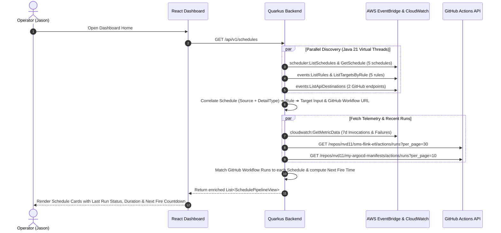
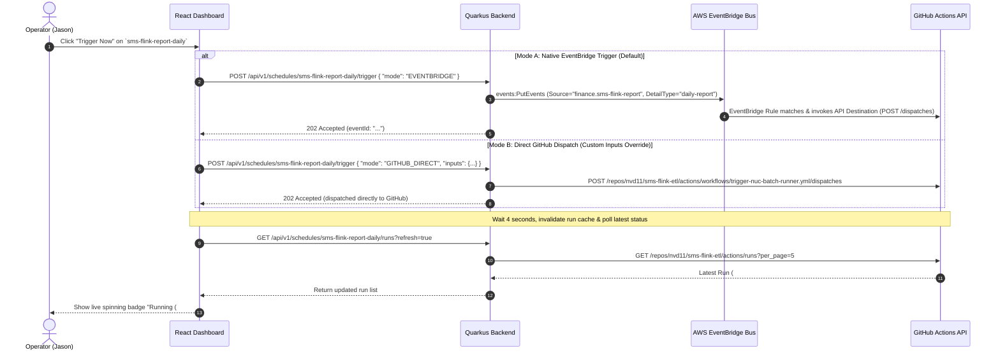

# System Architecture & Technical Specification

**Project Name:** AWS EventBridge Scheduler Dashboard (`aws-scheduler-dashboard`)  
**Architecture Style:** Stateless Cloud Control Plane (React 18 SPA + Quarkus 3.8 REST Backend)  
**Backend Runtime:** Java 21 + Quarkus 3.8 (Maven, AWS SDK for Java v2, REST Client Reactive)  
**Frontend Runtime:** React 18 + TypeScript + Vite + Tailwind CSS + Lucide Icons  
**Target Deployment:** K3s Cluster B (`tencent-dp1-cluster`) via ArgoCD GitOps + Kong Gateway  
**Document Version:** 1.0.0  

---

## 1. Architectural Overview & Why Quarkus?

Although this project is a **pure Dashboard & Control Plane** (and **not** a new scheduling engine), **Quarkus 3.8 (Java 21)** is selected for the backend REST API layer for three architectural reasons:
1. **Cluster Resource Efficiency**: In our K3s cluster (`tencent-dp1-cluster`), nodes run multiple workloads. A stateless Quarkus REST proxy starts in `<1 second` and consumes a fraction of the memory of a traditional Spring Boot container, while using standard JAX-RS (`jakarta.ws.rs.*`) annotations.
2. **Ecosystem Alignment**: Aligns with existing Java 21 Quarkus microservices in the cluster (`quarkus-svc`, `cctv-collector`, `cctv-uploader`), reusing our shared Helm chart (`my-shared-helm-charts/charts/generic-web-service-v2`) and GitHub Actions CI/CD templates.
3. **Non-Blocking Cloud API Fan-Out**: Fetching schedules from AWS Scheduler, rules from EventBridge, metrics from CloudWatch, and run histories from GitHub Actions involves parallel I/O calls. Java 21 **Virtual Threads (`@RunOnVirtualThread`)** in Quarkus allow clean, synchronous-style code that executes external AWS/GitHub HTTP calls concurrently with zero thread-pool exhaustion.

---

## 2. End-to-End System Architecture

```mermaid
flowchart TB
    subgraph Client["1. Presentation Layer (Browser)"]
        SPA["React 18 + Vite + Tailwind SPA<br/>• Schedule Inventory & Search<br/>• 3-Hop Topology Visualizer<br/>• Execution History Drawer<br/>• One-Click Trigger & Cron Editor"]
    end

    subgraph Gateway["2. K3s Edge & Security Layer (tencent-dp1-cluster)"]
        Kong["Kong Ingress Gateway<br/>(gw.jppwl.asia / gw-tx.jppwl.asia)"]
        SSO["OAuth2-Proxy (Logto Zero-Trust SSO)"]
        Kong <-->|Forward-Auth| SSO
    end

    subgraph Backend["3. Quarkus 3.8 Control Plane Backend (Java 21 Virtual Threads)"]
        API["SchedulerResource<br/>(/api/v1/schedules/*)"]
        Cache["Caffeine In-Memory Cache<br/>(Topology: 60s TTL | Runs: 15s TTL)"]
        
        subgraph Services["Core Domain Services"]
            TopoSvc["AwsTopologyService<br/>(Schedule ➔ Rule ➔ Target Resolver)"]
            ControlSvc["JobControlService<br/>(Enable/Disable, Edit Cron, Trigger)"]
            CorrelatorSvc["ExecutionCorrelatorService<br/>(Run Attribution & CloudWatch Merger)"]
        end

        subgraph Clients["External SDK & REST Clients"]
            SchedSdk["AWS SchedulerClient (SDK v2)"]
            EventsSdk["AWS EventBridgeClient (SDK v2)"]
            CwSdk["AWS CloudWatchClient (SDK v2)"]
            GhClient["GitHub Actions REST Client"]
        end

        API --> TopoSvc & ControlSvc & CorrelatorSvc
        TopoSvc & CorrelatorSvc <--> Cache
        TopoSvc --> SchedSdk & EventsSdk
        ControlSvc --> SchedSdk & EventsSdk & GhClient
        CorrelatorSvc --> CwSdk & GhClient
    end

    subgraph External["4. External Cloud Providers"]
        AWS["AWS ap-southeast-1 (Account: 186004631963)<br/>• EventBridge Scheduler<br/>• EventBridge Rules & API Destinations<br/>• CloudWatch Metrics"]
        GitHub["GitHub REST API (api.github.com)<br/>• nvd11/sms-flink-etl<br/>• nvd11/my-argocd-manifests"]
    end

    SPA -->|HTTPS| Kong
    Kong --> API
    SchedSdk & EventsSdk & CwSdk -->|HTTPS (IAM moon-cli)| AWS
    GhClient -->|HTTPS (Bearer GITHUB_TOKEN)| GitHub
```

---

## 3. Core Sequence Flows

### 3.1 Topology Discovery & Execution History Correlation Flow



### 3.2 One-Click Manual Trigger ("Run Now") Flow



---

## 4. Data Models & REST API Specification

### 4.1 Core Domain DTO (`SchedulePipelineView`)

```json
{
  "name": "sms-flink-report-daily",
  "groupName": "default",
  "arn": "arn:aws:scheduler:ap-southeast-1:186004631963:schedule/default/sms-flink-report-daily",
  "description": "Nightly 23:50 (Asia/Shanghai) financial daily report trigger",
  "state": "ENABLED",
  "scheduleExpression": "cron(50 23 * * ? *)",
  "timezone": "Asia/Shanghai",
  "humanReadableCron": "Every day at 23:50 (Asia/Shanghai)",
  "nextFireTime": "2026-10-17T15:50:00Z",
  "lastModifiedDate": "2026-10-14T18:30:06Z",
  "routing": {
    "eventBusName": "default",
    "source": "finance.sms-flink-report",
    "detailType": "daily-report",
    "matchedRuleName": "rule-trigger-github-daily-report",
    "apiDestinationName": "github-trigger-nuc-batch",
    "invocationEndpoint": "https://api.github.com/repos/nvd11/sms-flink-etl/actions/workflows/trigger-nuc-batch-runner.yml/dispatches",
    "githubOwner": "nvd11",
    "githubRepo": "sms-flink-etl",
    "workflowFile": "trigger-nuc-batch-runner.yml",
    "targetRef": "main",
    "defaultInputs": {
      "target_env": "finance",
      "pipeline_stage": "report",
      "report_period": "DAILY"
    }
  },
  "metrics7d": {
    "invocations": 7,
    "successfulInvocations": 7,
    "failedInvocations": 0
  },
  "lastExecution": {
    "runId": 1948271625,
    "runNumber": 88,
    "status": "completed",
    "conclusion": "success",
    "startedAt": "2026-10-16T15:50:04Z",
    "updatedAt": "2026-10-16T15:52:19Z",
    "durationSeconds": 135,
    "htmlUrl": "https://github.com/nvd11/sms-flink-etl/actions/runs/1948271625"
  }
}
```

### 4.2 REST API Endpoints (`SchedulerResource`)

| HTTP Method | Endpoint Path | Description |
| :---: | :--- | :--- |
| `GET` | `/api/v1/health` | Liveness and readiness check + AWS/GitHub connectivity status |
| `GET` | `/api/v1/schedules` | List all schedules with resolved topology, 7d metrics, and latest execution run |
| `GET` | `/api/v1/schedules/{name}` | Get detailed configuration and next 5 fire times for a single schedule |
| `GET` | `/api/v1/schedules/{name}/runs` | Get correlated GitHub Actions execution history (`?limit=20&refresh=false`) |
| `POST` | `/api/v1/schedules/{name}/trigger` | Manually trigger a schedule (`mode`: `EVENTBRIDGE` or `GITHUB_DIRECT`, optional `inputs`) |
| `PATCH` | `/api/v1/schedules/{name}/state` | Toggle schedule state (`{"state": "ENABLED" \| "DISABLED"}`) |
| `PUT` | `/api/v1/schedules/{name}` | Update schedule expression, timezone, or description |

---

## 5. Topology Correlation Algorithm

In AWS Account `186004631963`, schedules do not invoke GitHub directly; they follow a 3-stage decoupled pattern:
1. **Stage 1 (EventBridge Scheduler)**:
   - `Target.Arn` = `arn:aws:events:ap-southeast-1:186004631963:event-bus/default`
   - `Target.EventBridgeParameters` = `{ "Source": "<S>", "DetailType": "<D>" }`
2. **Stage 2 (EventBridge Rule on `default` bus)**:
   - `EventPattern` = `{"source": ["<S>"], "detail-type": ["<D>"]}` (or prefix match on `source` alone, as in `rule-trigger-github-workflow` where `source=["finance.sms-flink"]`).
   - Rule `Target.Input` = JSON payload sent to GitHub (e.g., `{"ref":"main","inputs":{...}}`).
   - Rule `Target.Arn` = `arn:aws:events:...:api-destination/<dest-name>/<uuid>`.
3. **Stage 3 (EventBridge API Destination)**:
   - `InvocationEndpoint` = `https://api.github.com/repos/{owner}/{repo}/actions/workflows/{workflow_file}/dispatches`.

`AwsTopologyService` builds this lookup graph in memory (cached for 60s) by:
1. Indexing all `ApiDestinations` by their ARN and parsing `{owner}`, `{repo}`, and `{workflow_file}` via regex `repos/([^/]+)/([^/]+)/actions/workflows/([^/]+)/dispatches`.
2. Indexing all EventBridge `Rules` and their `Targets`, parsing each rule's `EventPattern` JSON.
3. Matching each `Schedule`'s `(Source, DetailType)` tuple against the indexed `EventPattern` criteria to bind the complete pipeline metadata.

---

## 6. Deployment & GitOps Integration Plan

When ready for deployment to K3s (`tencent-dp1-cluster`):
- **Container Packaging**: Single deployable unit (Quarkus serves the compiled React static bundle from `META-INF/resources` or deployed as frontend/backend via `generic-web-service-v2` Helm chart).
- **Target Node**: `nuc` (`x86_64`) or `free-arm-vm` (`arm64`), consuming `<180MB RAM`.
- **Gateway Route**: Exposed via Kong Gateway `HTTPRoute` at `https://gw.jppwl.asia/scheduler` (protected by `oauth2-forward-auth` Logto SSO).
