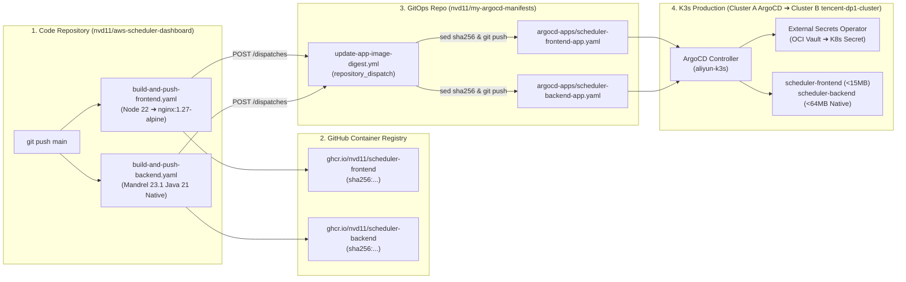

# Deployment, GitOps & CI/CD Specification

**Document Version:** 1.0.0  
**Project Name:** AWS EventBridge Scheduler Dashboard (`aws-scheduler-dashboard`)  
**Target Cluster:** K3s Cluster B (`tencent-dp1-cluster`) managed by ArgoCD on Cluster A (`aliyun-k3s`)  
**Target Namespace:** `default`  
**Target Node:** `radxa-cubie-a7a` (`linux/arm64` / `aarch64` · Moon Edge Node)  
**Shared Helm Chart:** `https://github.com/nvd11/my-shared-helm-charts.git` (`charts/generic-web-service-v2`)  
**Edge Gateway & Auth:** Cloudflare Same-Origin (`gw.jppwl.asia` / `gw-tx.jppwl.asia`) + Kong (`oauth2-forward-auth`) + Logto (GitHub SSO)  

---

## 1. End-to-End CI/CD & GitOps Deployment Pipeline

Aligned 1:1 with `astra` (`astra-frontend` & `astra-backend`) and `higress-dashboard`, the deployment pipeline follows a zero-touch **GitHub Actions ➔ GHCR ➔ `my-argocd-manifests` Repository Dispatch ➔ ArgoCD Sync** workflow:



---

## 2. Container Packaging & Native Compilation Specs

### 2.1 Backend GraalVM / Mandrel Native Image (`backend/Dockerfile.native`)

To guarantee the strict **<64MB RAM** memory footprint on K3s, `scheduler-backend` is compiled into a standalone native Linux executable using Quarkus Mandrel (GraalVM for JDK 21) and packaged into `quarkus-micro-image:2.0` with `ca-certificates` and `tzdata`:

```dockerfile
# ==============================================================================
# Stage 1: GraalVM / Mandrel Native Compilation (Java 21)
# ==============================================================================
FROM quay.io/quarkus/ubi-quarkus-mandrel-builder-image:jdk-21 AS builder

WORKDIR /build

# 1. Cache Maven dependencies first
COPY --chown=quarkus:quarkus pom.xml .
USER quarkus
RUN ./mvnw -B dependency:go-offline || mvn -B dependency:go-offline

# 2. Copy source and compile native executable
COPY --chown=quarkus:quarkus src ./src
RUN mvn -B package -Dnative -DskipTests \
    -Dquarkus.native.additional-build-args="-H:+ReportExceptionStackTraces"

# ==============================================================================
# Stage 2: Minimal ARM64 Runtime Image (ubi-minimal + CA certs + tzdata)
# Note: ubi9-minimal provides native linux/arm64 glibc/libz + ca-certificates + tzdata
# ==============================================================================
FROM registry.access.redhat.com/ubi9/ubi-minimal:9.4
WORKDIR /work/

RUN microdnf install -y ca-certificates tzdata \
    && microdnf clean all \
    && chown 1001 /work \
    && chmod "g+rwX" /work \
    && chown 1001:root /work

# Copy ARM64 native runner binary
COPY --from=builder --chown=1001:root /build/target/*-runner /work/application

EXPOSE 8080
USER 1001

# Cap Native Heap at 48MB to strictly enforce <64MB container RSS on radxa-cubie-a7a
ENTRYPOINT ["./application", "-Dquarkus.http.host=0.0.0.0", "-Xmx48m", "-Xms16m"]
```

> **Native ARM64 (`aarch64`) Compilation Strategy in GitHub Actions (For `radxa-cubie-a7a`)**:
> Because `radxa-cubie-a7a` is an **ARM64 (`aarch64`)** node and GraalVM `native-image` compilation under QEMU emulation (`ubuntu-latest` x86_64) is extremely slow and prone to OOM/timeout, `build-and-push-backend.yaml` MUST run natively on GitHub's official ARM64 runner (**`runs-on: ubuntu-24.04-arm`**) with **`platforms: linux/arm64`**.
> - Native ARM64 Mandrel compilation completes in **~2.5 minutes** with zero QEMU overhead.
> - For `quarkus-micro-image:2.0` on ARM64, the multi-stage runtime image uses `registry.access.redhat.com/ubi9/ubi-minimal:9.4` (`linux/arm64`) so `glibc`, `libstdc++`, `libz`, `ca-certificates`, and `tzdata` match `aarch64` natively.

---

### 2.2 Frontend Nginx Alpine Image (`web/Dockerfile` & `web/nginx.conf`)

Identical to `astra/frontend/Dockerfile`:

```dockerfile
# ==============================================================================
# Stage 1: Static Vite Build on Native Builder Architecture
# ==============================================================================
FROM --platform=$BUILDPLATFORM node:22-alpine AS builder
WORKDIR /app
COPY package.json package-lock.json ./
RUN npm ci
COPY . .
RUN npm run build

# ==============================================================================
# Stage 2: Ultra-Light Nginx 1.27 Alpine Runner (<15MB RAM)
# ==============================================================================
FROM nginx:1.27-alpine AS runner
RUN rm -rf /etc/nginx/conf.d/default.conf /usr/share/nginx/html/*
COPY --from=builder /app/dist /usr/share/nginx/html/scheduler
RUN ln -s /usr/share/nginx/html/scheduler/index.html /usr/share/nginx/html/index.html
COPY nginx.conf /etc/nginx/conf.d/default.conf

EXPOSE 80
HEALTHCHECK --interval=30s --timeout=5s --start-period=5s --retries=3 \
  CMD wget --quiet --tries=1 --spider http://127.0.0.1/health || exit 1
CMD ["nginx", "-g", "daemon off;"]
```

--- 

## 3. OCI Vault & ExternalSecret Specification

Aligned with `higress-dashboard-backend` and `dbgate`, **zero plaintext credentials** are stored in Git. Sensitive keys are stored in **OCI Vault (`ap-singapore-1`)** and synced into Kubernetes via **External Secrets Operator (ESO)**.

### 3.1 Required OCI Vault Secrets

| OCI Vault Secret Name | Target K8s Secret Key (`scheduler-backend-secrets`) | Description |
| :--- | :--- | :--- |
| **`scheduler-aws-access-key-id`** | `AWS_ACCESS_KEY_ID` | IAM User `moon-cli` Access Key ID (`186004631963`) |
| **`scheduler-aws-secret-access-key`** | `AWS_SECRET_ACCESS_KEY` | IAM User `moon-cli` Secret Access Key |
| **`scheduler-github-token`** | `GITHUB_TOKEN` | GitHub PAT (`nvd11`) with `repo` and `workflow` scopes |

*(Note: If the target namespace is `higress-system` or `default`, it reuses the existing `SecretStore` `oci-litellm-vault-store` or `oci-vault-store` directly.)*

---

## 4. ArgoCD Application Manifests (`nvd11/my-argocd-manifests`)

### 4.1 Frontend ArgoCD App (`argocd-apps/scheduler-frontend-app.yaml`)

```yaml
apiVersion: argoproj.io/v1alpha1
kind: Application
metadata:
  name: scheduler-frontend
  namespace: argocd
  finalizers:
    - resources-finalizer.argocd.argoproj.io
  labels:
    app.kubernetes.io/name: scheduler-frontend
    app.kubernetes.io/part-of: aws-scheduler-dashboard
spec:
  project: default
  source:
    repoURL: https://github.com/nvd11/my-shared-helm-charts.git
    path: charts/generic-web-service-v2
    targetRevision: main
    helm:
      values: |
        replicaCount: 1
        containerPort: 80

        image:
          repository: ghcr.io/nvd11/scheduler-frontend
          digest: sha256:0000000000000000000000000000000000000000000000000000000000000000
          pullPolicy: IfNotPresent

        resources:
          requests:
            cpu: 10m
            memory: 16Mi
          limits:
            cpu: 100m
            memory: 32Mi

        livenessProbe:
          enabled: true
          path: /health
          port: http
          initialDelaySeconds: 5
          periodSeconds: 20
          failureThreshold: 3

        readinessProbe:
          enabled: true
          path: /health
          port: http
          initialDelaySeconds: 5
          periodSeconds: 10
          failureThreshold: 3

        service:
          type: ClusterIP
          port: 80
          annotations:
            konghq.com/plugins: oauth2-forward-auth

        route:
          enabled: true
          parentGateway: kong-main-gateway
          parentGatewayNamespace: default
          path: /scheduler
          pathType: PathPrefix
          annotations:
            konghq.com/plugins: oauth2-forward-auth

        nodeSelector:
          kubernetes.io/hostname: radxa-cubie-a7a

  destination:
    name: tencent-dp1-cluster
    namespace: default
  syncPolicy:
    automated:
      prune: true
      selfHeal: true
    syncOptions:
      - CreateNamespace=true
      - RespectIgnoreDifferences=true
  ignoreDifferences:
    - group: gateway.networking.k8s.io
      kind: HTTPRoute
      jsonPointers:
        - /status
```

---

### 4.2 Backend ArgoCD App (`argocd-apps/scheduler-backend-app.yaml`)

```yaml
apiVersion: argoproj.io/v1alpha1
kind: Application
metadata:
  name: scheduler-backend
  namespace: argocd
  finalizers:
    - resources-finalizer.argocd.argoproj.io
  labels:
    app.kubernetes.io/name: scheduler-backend
    app.kubernetes.io/part-of: aws-scheduler-dashboard
spec:
  project: default
  source:
    repoURL: https://github.com/nvd11/my-shared-helm-charts.git
    path: charts/generic-web-service-v2
    targetRevision: main
    helm:
      values: |
        replicaCount: 1
        containerPort: 8080

        image:
          repository: ghcr.io/nvd11/scheduler-backend
          digest: sha256:0000000000000000000000000000000000000000000000000000000000000000
          pullPolicy: IfNotPresent

        resources:
          requests:
            cpu: 20m
            memory: 36Mi
          limits:
            cpu: 200m
            memory: 64Mi

        envFrom:
          - configMapRef:
              name: scheduler-backend-config
          - secretRef:
              name: scheduler-backend-secrets

        configMap:
          enabled: true
          name: scheduler-backend-config
          data:
            QUARKUS_HTTP_PORT: "8080"
            APP_ENV: "prod"
            APP_AUTH_ENABLED: "true"
            APP_AUTH_MODE: "forward-auth"
            APP_LOGTO_ENDPOINT: "https://sodaxw.logto.app"
            AWS_REGION: "ap-southeast-1"
            AWS_ACCOUNT_ID: "186004631963"
            AWS_SCHEDULER_GROUP: "default"
            AWS_EVENT_BUS_NAME: "default"
            GITHUB_API_BASE_URL: "https://api.github.com"
            TOPOLOGY_CACHE_TTL_SECONDS: "60"
            RUN_HISTORY_CACHE_TTL_SECONDS: "15"

        externalSecret:
          enabled: true
          refreshInterval: 1h
          secretStoreRef:
            name: oci-vault-store
            kind: SecretStore
          target:
            name: scheduler-backend-secrets
            creationPolicy: Owner
          data:
            - secretKey: AWS_ACCESS_KEY_ID
              remoteRef:
                key: scheduler-aws-access-key-id
            - secretKey: AWS_SECRET_ACCESS_KEY
              remoteRef:
                key: scheduler-aws-secret-access-key
            - secretKey: GITHUB_TOKEN
              remoteRef:
                key: scheduler-github-token

        livenessProbe:
          enabled: true
          path: /live
          port: 8080
          initialDelaySeconds: 3
          periodSeconds: 15
          failureThreshold: 3

        readinessProbe:
          enabled: true
          path: /ready
          port: 8080
          initialDelaySeconds: 3
          periodSeconds: 10
          failureThreshold: 3

        service:
          type: ClusterIP
          port: 8080
          annotations:
            konghq.com/plugins: oauth2-forward-auth
            konghq.com/read-timeout: "60000"
            konghq.com/write-timeout: "60000"
            konghq.com/connect-timeout: "15000"

        route:
          enabled: true
          parentGateway: kong-main-gateway
          parentGatewayNamespace: default
          path: /scheduler/api
          pathType: PathPrefix
          annotations:
            konghq.com/strip-path: "true"
            konghq.com/plugins: oauth2-forward-auth
            konghq.com/read-timeout: "60000"
            konghq.com/write-timeout: "60000"
            konghq.com/connect-timeout: "15000"

        nodeSelector:
          kubernetes.io/hostname: radxa-cubie-a7a

  destination:
    name: tencent-dp1-cluster
    namespace: default
  syncPolicy:
    automated:
      prune: true
      selfHeal: true
    syncOptions:
      - CreateNamespace=true
      - RespectIgnoreDifferences=true
  ignoreDifferences:
    - group: ""
      kind: Secret
      name: scheduler-backend-secrets
      jsonPointers:
        - /data
    - group: gateway.networking.k8s.io
      kind: HTTPRoute
      jsonPointers:
        - /status
```

---

## 5. GitOps Digest Auto-Updater Integration

In `nvd11/my-argocd-manifests/.github/workflows/update-app-image-digest.yml`, register `scheduler-backend` and `scheduler-frontend` in the service allowlist:

```bash
if [[ "$SVC_NAME" != "litellm-svc" && \
      "$SVC_NAME" != "astra-backend" && \
      "$SVC_NAME" != "astra-frontend" && \
      "$SVC_NAME" != "scheduler-backend" && \
      "$SVC_NAME" != "scheduler-frontend" && \
      ... ]]; then
```

And configure two repository variables/secrets in `nvd11/aws-scheduler-dashboard`:
- **Repository Variable**: `ENABLE_GITOPS_DIGEST_DISPATCH = true`
- **Repository Secret**: `ARGOCD_MANIFESTS_DISPATCH_TOKEN` (GitHub PAT with `repo` write access to `nvd11/my-argocd-manifests`).

---

## 6. Downstream Workflow Enhancement (`run-name` Attribution Tagging)

To enable **100% deterministic Tier-1 Run Attribution (`DISPLAY_TITLE`)** across the 4 Flink schedules sharing `nvd11/sms-flink-etl/.github/workflows/trigger-nuc-batch-runner.yml`, add the following `run-name` expression to the top of `trigger-nuc-batch-runner.yml`:

```yaml
name: Trigger NUC Batch Runner
run-name: "Batch ETL [${{ inputs.pipeline_stage || 'all' }} | ${{ inputs.report_period || 'INCREMENTAL' }} | ${{ inputs.target_env || 'finance' }}]"
```

- When `test-sms-flink-cron` fires (`pipeline_stage=all`), `display_title` becomes: `Batch ETL [all | DAILY | finance]`.
- When `sms-flink-report-daily` fires (`pipeline_stage=report`, `report_period=DAILY`), `display_title` becomes: `Batch ETL [report | DAILY | finance]`.
- When `sms-flink-report-weekly` fires (`pipeline_stage=report`, `report_period=WEEKLY`), `display_title` becomes: `Batch ETL [report | WEEKLY | finance]`.
- When `sms-flink-report-monthly` fires (`pipeline_stage=report`, `report_period=MONTHLY`), `display_title` becomes: `Batch ETL [report | MONTHLY | finance]`.

---

## 7. Production Verification Checklist

1. **OCI Vault Secret Check**:
   ```bash
   kubectl get externalsecret scheduler-backend-secrets -n default
   # Verify STATUS = SecretSynced and READY = True
   ```
2. **Pod Footprint & Native Startup Check**:
   ```bash
   kubectl top pod -l app.kubernetes.io/instance=scheduler-backend -n default
   # Verify MEMORY(bytes) < 55Mi
   ```
3. **Same-Origin & Kong Forward-Auth Check**:
   - Unauthenticated `curl -I https://gw.jppwl.asia/scheduler/` ➔ Returns `302 Found` with `Location: /oauth2/start?rd=/scheduler/`.
   - Unauthenticated `curl -H "Accept: application/json" https://gw.jppwl.asia/scheduler/api/v1/schedules` ➔ Returns `401 Unauthorized`.
   - Authenticated browser session at `https://gw.jppwl.asia/scheduler/` ➔ Loads SPA, displays GitHub user `nvd11`, and renders all 5 AWS schedules with live countdowns and attributed GitHub run histories.
